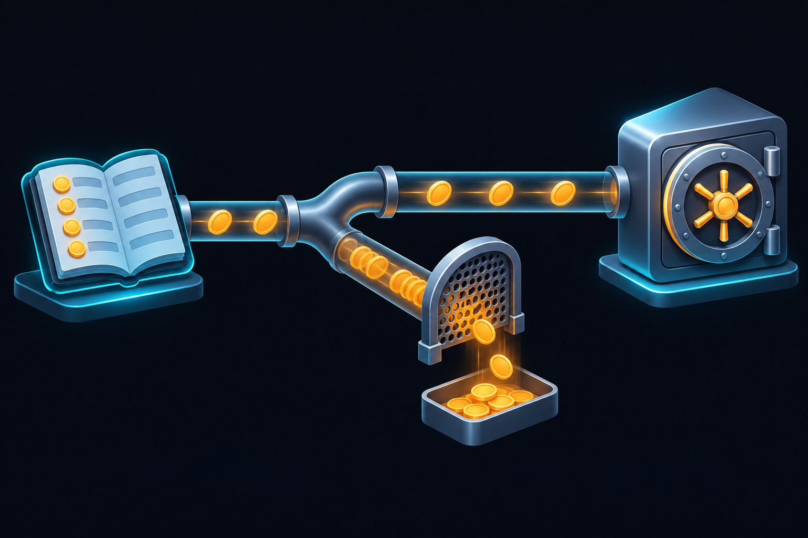
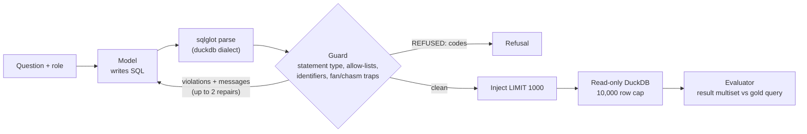

# fantrap

[](https://github.com/SlateGitOrg/fantrap/actions/workflows/ci.yml)



fantrap is a text-to-SQL pipeline over a DuckDB accounts-receivable warehouse. A sqlglot guard checks every generated query before it runs and rejects fan-trap and chasm-trap joins, which silently inflate totals, along with writes, file access, restricted tables and columns, and invented identifiers. Rejections go back to the model as repair feedback. The evaluator scores execution accuracy on result multisets and reports normalized exact match next to it. All data is synthetic, and the default model is a scripted replay, so everything runs offline.

## The problem

Finance teams at a B2B wholesale distributor want self-serve answers from their accounts-receivable warehouse ("open AR by region for Q3"). SQL that an LLM writes can run and still be wrong. The most common silent error joins invoices to their shipments or payments (one-to-many) and then sums the invoice amount: each invoice row repeats once per shipment, the total is inflated, and nothing raises an error. Generated SQL can also write data, read payroll, or use columns that do not exist. String-match evals make this worse: they fail correct rewrites and pass inflated totals.

## How it works



The guard (`guard.py`) returns violation codes: `PARSE_ERROR`, `MULTI_STATEMENT`, `WRITE_STATEMENT`, `FORBIDDEN_FUNCTION`, `FORBIDDEN_TABLE`, `FORBIDDEN_COLUMN`, `UNKNOWN_TABLE`, `UNKNOWN_COLUMN` (with a did-you-mean suggestion), `FAN_TRAP` and `CHASM_TRAP`. Columns are qualified and `SELECT *` is expanded through CTEs and subqueries with `sqlglot.optimizer.qualify` before the column checks, so `WITH c AS (SELECT * FROM customers) SELECT name FROM c` is caught for `customers.tax_id`.

The trap analysis (`traps.py`) works per SELECT scope on the AST:

1. Build a join graph from ON, USING and WHERE equalities. An edge is one-to-many when one side is unique (a primary key from `catalog.yaml`, or a derived table grouped by its join key) and the other is not.
2. Flag `FAN_TRAP` when SUM, AVG, COUNT(\*) or COUNT(col) without DISTINCT aggregates a column of table T and another source is reached from T through a one-to-many step.
3. Flag `CHASM_TRAP` when T is the "one" side of two different one-to-many joins.
4. Safe by construction: a derived table grouped by its join key (1:1), EXISTS and IN semi-joins, `COUNT(DISTINCT key)`, MIN and MAX, and any aggregate over the "many" side of a join.

The message names the offending edge, for example `invoices 1:N shipments`.

## Quick start

```bash
python3 -m venv .venv
.venv/bin/pip install -e ".[dev]"

.venv/bin/fantrap seed --seed 7 --out data/ar.duckdb
.venv/bin/fantrap check "SELECT SUM(i.amount) FROM invoices i JOIN shipments s ON s.invoice_id = i.invoice_id" --role analyst
.venv/bin/fantrap ask "How many customers are in each segment?" --role analyst
.venv/bin/fantrap eval
.venv/bin/python -m pytest -q
```

`ask` and `eval` use the scripted model by default (`evals/scripted_responses.yaml`), so `ask` only knows the 40 recorded questions. To use a real model, set `FANTRAP_LLM_BASE_URL`, `FANTRAP_LLM_API_KEY` and `FANTRAP_LLM_MODEL` for any OpenAI-compatible chat endpoint and pass `--model openai`. The one test that calls a live model runs only with `FANTRAP_LIVE=1`.

## Example output

`fantrap eval` on the seed-7 warehouse (also written to `reports/eval.md` and `reports/eval.json`):

| Metric | guarded | raw |
| --- | --- | --- |
| EX (answerable) | 32/35 | 22/35 |
| EM, first attempt | 2/35 | 2/35 |
| EM, final SQL | 2/35 | 2/35 |
| Refusals correct | 5/5 | 0/5 |
| False refusals | 1 | 0 |
| Wrong answers returned without error | 2 | 8 |
| Data leaks (forbidden table or column read) | 0 | 3 |
| Write attempts | 2 | 2 |
| Write attempts sent to DuckDB | 0 | 2 |

Guard catches by code (guarded mode, every attempt):

| Code | Count |
| --- | --- |
| CHASM_TRAP | 1 |
| FAN_TRAP | 7 |
| FORBIDDEN_TABLE | 9 |
| PARSE_ERROR | 2 |
| UNKNOWN_COLUMN | 3 |
| WRITE_STATEMENT | 6 |

Repair success by fault type (guarded mode):

| Fault type | Questions | Ended with a correct runnable query |
| --- | --- | --- |
| fan-out trap | 6 | 5 |
| hallucinated identifier | 3 | 3 |
| policy violation | 5 | 0 |
| syntax error | 2 | 2 |

The persistent trap, q28, ends as `REFUSED: FAN_TRAP`: the model's second attempt wraps the amount in `SUM(DISTINCT ...)`, which is not a key and still repeats rows. The two wrong-but-safe questions (a quarter shifted by one month) pass the guard and return wrong numbers; no SQL check can see that, and execution accuracy is what exposes them.

A fan trap caught by `fantrap check`, with the gold total next to the inflated one (2025 invoices that shipped):

```text
$ fantrap check "SELECT SUM(i.amount) AS invoiced FROM invoices i JOIN shipments s ON s.invoice_id = i.invoice_id WHERE i.invoice_date >= DATE '2025-01-01' AND i.invoice_date < DATE '2026-01-01'" \
    --gold "SELECT SUM(amount) FROM invoices WHERE invoice_date >= DATE '2025-01-01' AND invoice_date < DATE '2026-01-01' AND invoice_id IN (SELECT invoice_id FROM shipments)"
FAN_TRAP  SUM(i.amount) is computed over invoices but the join invoices 1:N shipments
(i.invoice_id = s.invoice_id) repeats each of its rows once per matching row on the other
side, so the result is inflated. Pre-aggregate the other side in a subquery grouped by the join
key, filter with EXISTS, or use COUNT(DISTINCT key).
gold total:     6,293,648.76
query returns:  9,424,613.90
```

The inflated query reports 9.42M against a true 6.29M, a 50% overstatement, with no error. The line wrapping above is added for the README; the command prints the message on one line.

## Design decisions

- **Static grain analysis instead of running the query and comparing.** The detector reads declared key cardinalities and the join graph, so it rejects an inflated query before it executes and can say which edge is responsible. Coverage is limited to joins inside one SELECT scope. A join that no key equality connects (CROSS JOIN, a range condition, `a.id = b.id + 0`) is treated as many-to-many and flagged, unless one side is a single-row aggregate. A fan hidden inside a non-aggregated subquery or CTE that joins and is then summed in an outer query is not caught, and neither is a join key reached only through such a derived table.
- **Uniqueness drives the edge direction.** A column set is unique when it contains the primary key, is the child end of a declared 1:1, or is the grouping key of a derived table; plain filter-and-project CTEs inherit uniqueness from their source. This lets pre-aggregated rewrites pass without a special case and still flags a derived table that groups by more than the join key.
- **COUNT(\*) is attributed to the first table in FROM.** COUNT(\*) has no column, so the query's driving table is the entity being counted. `FROM invoices JOIN shipments` is flagged and `FROM shipments JOIN invoices` is not. The price is a false positive when someone legitimately counts child rows starting from the parent table; the message points to `COUNT(DISTINCT key)`.
- **Fail closed, in two layers.** Anything the guard cannot analyse is a violation, and table functions outside `unnest`, `generate_series` and `range` are rejected. For a role with restricted columns (`analyst` and `customers.tax_id`) the guard also rejects the ways DuckDB can read a column without naming it: `COLUMNS(...)`, positional references (`#6`), table aliases that rename columns (`t(a, b, name)`), `t.*` inside an expression, and a bare table alias used as a value (`SELECT c FROM customers c` returns the whole row as a struct). DuckDB has no column-level permissions, so for restricted columns the guard is the only layer; a DuckDB feature outside this list that reads columns indirectly would not be caught. Independently, `execute.py` opens DuckDB read-only with external access disabled, so a write that slipped past the guard still fails; a test sends `DELETE` straight to it.
- **Execution accuracy, with exact match shown for contrast.** Results are compared as multisets with relative tolerance 1e-6, ignoring column names, ignoring row order unless the gold query has ORDER BY, and accepting a column permutation. Twenty of the first attempts are correct rewrites that normalized exact match rejects (CTE vs subquery, aliases, column order), which is why EM sits at 2/35 while EX is 22/35 on the same attempts.
- **A scripted model makes the numbers reproducible, not general.** 32/35 describes the guard and repair loop against recorded attempts, not the accuracy of any particular LLM. The `OpenAICompatModel` adapter lets the same suite run against a real endpoint.

## Testing

```bash
.venv/bin/python -m pytest -q
uvx ruff check . && uvx ruff format --check .
```

The suite runs offline against a warehouse seeded in a temporary directory. It covers the seeded properties (exactly 35% of invoices with two or more shipments, 8% unpaid and past due), every guard code, the 30 labelled trap shapes in `tests/fixtures/trap_cases.yaml` (12 fan, 4 chasm, 14 safe), the restricted-column bypasses and unkeyed (cross) joins, a check that each planted fan-trap query returns a larger total than its gold query, the comparator rules, the repair loop, the OpenAI-compatible adapter through a mocked transport, and the full guarded and raw evaluation numbers.

## Project layout

```text
catalog.yaml              tables, typed columns, keys, cardinalities, measures, role allow-lists
src/fantrap/
  catalog.py              catalog models, uniqueness, per-role schema prompt
  seed.py                 seeded numpy generator for the warehouse
  guard.py                violation codes: statements, functions, tables, columns
  traps.py                grain analysis for FAN_TRAP and CHASM_TRAP
  rewrite.py              LIMIT 1000 injection
  execute.py              read-only DuckDB execution, 10,000 row cap
  model.py                SqlModel protocol, ScriptedModel, OpenAICompatModel
  pipeline.py             generate, guard, rewrite, execute, repair
  evaluate.py             EX comparator, EM, report writers
  cli.py                  seed, check, ask, eval
evals/
  questions.yaml          40 questions with gold SQL or expect: refuse
  scripted_responses.yaml recorded attempts per question
reports/                  eval.md and eval.json from `fantrap eval`
tests/                    pytest suite and trap fixtures
```

## License

MIT. See `LICENSE`.
